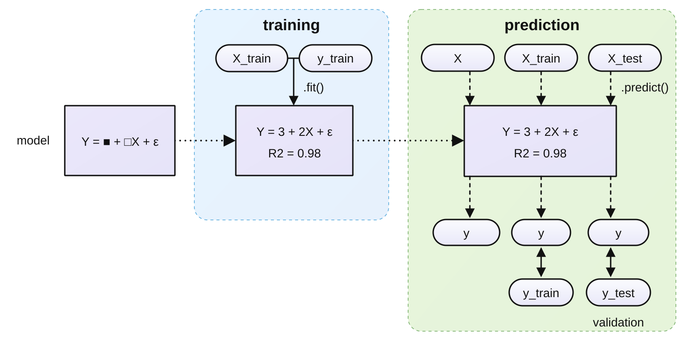

# 教師あり学習のワークフロー

- モデルを選択してオブジェクトを作ります
- データ(X_train, y_train)　でmodelを訓練します=学習させます=母数を推定します `.fit()`
  - X_train からyを予測します
  - y とy_trainを比較してします
    - 決定係数などで，model+母数の性能を評価します，
- model+母数で，Xからyを予測します `.predict()`
- 訓練データとは別の検証データ(X_test, y_test)でmodel+母数を検証します
  - 決定係数などで，modelの性能を評価します

